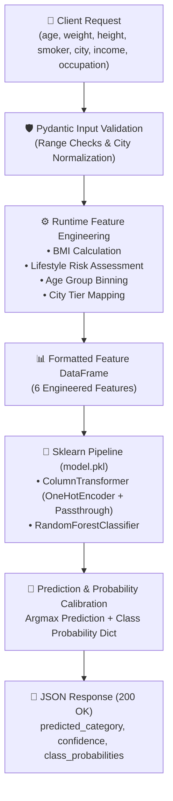

# 🛡️ Insurance Premium Prediction API

[](https://www.python.org/)
[](https://fastapi.tiangolo.com/)
[](https://scikit-learn.org/)
[](https://docs.pydantic.dev/)
[](https://www.docker.com/)
[](https://github.com/astral-sh/uv)
[](notebook/fastapi_ml_model.ipynb)
[](https://opensource.org/licenses/MIT)

An end-to-end, production-grade Machine Learning REST microservice built with **Python**, **FastAPI**, **Scikit-Learn**, and **Pydantic v2**. It predicts an individual's health insurance premium category (`Low` / `Medium` / `High`) along with calibrated probability distributions, powered by synchronized runtime feature engineering (BMI, lifestyle risk tiers, age groups, and curated Indian city tiers) with **zero training-serving skew**.

---

## 📑 Table of Contents

- [Overview](#-overview)
- [Key Features](#-key-features)
- [System Architecture & Workflow](#-system-architecture--workflow)
  - [End-to-End Pipeline Workflow](#end-to-end-pipeline-workflow)
  - [Feature Engineering & Domain Rules](#feature-engineering--domain-rules)
- [Tech Stack](#-tech-stack)
- [Project Structure](#-project-structure)
- [Dataset & Schema](#-dataset--schema)
- [Model Details & Evaluation](#-model-details--evaluation)
- [API Reference & Endpoints](#-api-reference--endpoints)
  - [1. Root Welcome (`GET /`)](#1-root-welcome-get-)
  - [2. Health Check (`GET /health`)](#2-health-check-get-health)
  - [3. Premium Prediction (`POST /predict`)](#3-premium-prediction-post-predict)
  - [4. Interactive Swagger Documentation](#4-interactive-swagger-documentation)
- [Getting Started](#-getting-started)
  - [Prerequisites](#prerequisites)
  - [Option 1: Setup with uv (Recommended)](#option-1-setup-with-uv-recommended)
  - [Option 2: Setup with pip](#option-2-setup-with-pip)
  - [Running the API](#running-the-api)
- [Docker Deployment](#-docker-deployment)
- [Author & Acknowledgments](#-author--acknowledgments)

---

## 🌟 Overview

Actuarial underwriting for healthcare insurance is traditionally a manual, rule-heavy, and time-consuming process. This service automates applicant risk categorization into precise premium tiers (**Low**, **Medium**, **High**) with calibrated multi-class confidence scores.

By bridging an offline **Scikit-Learn Random Forest Pipeline** with a real-time **FastAPI** web service, this architecture eliminates common production issues like *training-serving skew* by utilizing **Pydantic v2 computed properties** that replicate the training data preprocessing logic at runtime.

---

## ✨ Key Features

- **🎯 Multi-Class Premium Categorization**: Evaluates demographic, biometric, and socio-economic risk factors to classify applicants into `Low`, `Medium`, or `High` tiers.
- **📊 Calibrated Probability Scoring**: Outputs exact class-level confidence scores (`class_probabilities`) alongside the predicted label for auditable decision-making.
- **⚙️ Synchronized Feature Engineering**: Pydantic v2 `@computed_field` properties guarantee that input derivations (BMI, age group, lifestyle risk, city tier) stay perfectly identical between offline model training and live API inference.
- **🛡️ Strict Data Validation & Sanitization**: Enforces strict boundaries (e.g., positive weights, height limits, realistic age ranges) and sanitizes city text strings dynamically via `@field_validator`.
- **🏙️ Curated Indian City Tier Engine**: Automatically categorizes cities into Tier 1 (Metros), Tier 2 (Emerging urban centers), and Tier 3 to capture geographic cost-of-living differences.
- **⚡ High-Performance FastAPI Engine**: Asynchronous, lightweight REST microservice with sub-10ms inference latencies and auto-generated OpenAPI / Swagger docs.
- **🐳 Containerized & Reproducible**: Fully reproducible environment with Astral `uv` dependency locking and a production-hardened `Dockerfile` based on `python:3.14-slim`.

---

## 🧠 System Architecture & Workflow

### End-to-End Pipeline Workflow



### Feature Engineering & Domain Rules

The service converts 7 raw inputs into 6 model features:

1. **Body Mass Index (BMI)**:
   $$\text{BMI} = \frac{\text{weight (kg)}}{\text{height (m)}^2}$$

2. **Lifestyle Risk Matrix**:
   Combines smoking habits and BMI thresholds into a unified risk rating:
   $$\text{lifestyle\_risk} = \begin{cases} \text{high} & \text{if } \text{smoker} = \text{True} \land \text{BMI} > 30 \\ \text{medium} & \text{if } \text{smoker} = \text{True} \lor \text{BMI} > 27 \\ \text{low} & \text{otherwise} \end{cases}$$

3. **Age Group Stratification**:
   $$\text{age\_group} = \begin{cases} \text{young} & \text{age} < 25 \\ \text{adult} & 25 \le \text{age} < 45 \\ \text{middle\_aged} & 45 \le \text{age} < 60 \\ \text{senior} & \text{age} \ge 60 \end{cases}$$

4. **Geographic City Tiers**:
   - **Tier 1 (7 Metros)**: Mumbai, Delhi, Bangalore, Chennai, Kolkata, Hyderabad, Pune.
   - **Tier 2 (48 Emerging Hubs)**: Jaipur, Chandigarh, Indore, Lucknow, Patna, Visakhapatnam, Bhopal, Nagpur, Surat, Noida, etc.
   - **Tier 3**: All other municipalities.

---

## 🛠️ Tech Stack

| Domain | Technologies & Libraries |
| :--- | :--- |
| **Language & Environment** | Python 3.14, [uv](https://github.com/astral-sh/uv) (blazing fast package management & resolver) |
| **Web Framework & Server** | [FastAPI](https://fastapi.tiangolo.com/), [Uvicorn](https://www.uvicorn.org/) |
| **Validation & Schema** | [Pydantic v2](https://docs.pydantic.dev/) (`BaseModel`, `computed_field`, `field_validator`, `Annotated`) |
| **Machine Learning & Data** | [Scikit-Learn](https://scikit-learn.org/) (`Pipeline`, `ColumnTransformer`, `RandomForestClassifier`), [Pandas](https://pandas.pydata.org/), [NumPy](https://numpy.org/) |
| **Model Serialization** | `pickle` |
| **Containerization** | [Docker](https://www.docker.com/) (`python:3.14-slim`, cache mounts, non-root best practices) |

---

## 📁 Project Structure

```text
insurance-premium-prediction/
├── app.py                         # FastAPI application entrypoint (/, /health, /predict)
├── config/
│   └── city_tier.py               # Curated lists of Tier 1 & Tier 2 Indian cities
├── data/
│   └── insurance.csv              # Actuarial training dataset (100 records)
├── model/
│   ├── model.pkl                  # Serialized Scikit-Learn Pipeline artifact
│   └── predict.py                 # Prediction wrapper, versioning & probability mapping
├── notebook/
│   └── fastapi_ml_model.ipynb     # Model training, exploratory data analysis & evaluation
├── schema/
│   ├── user_input.py              # Pydantic input schema with validators & computed fields
│   └── prediction_response.py     # Pydantic output schema with Swagger documentation examples
├── Dockerfile                     # Optimized container image (Python 3.14-slim + uv)
├── pyproject.toml                 # Project metadata & dependency declarations
├── uv.lock                        # Deterministic locked dependency graph
└── README.md                      # Project documentation
```

---

## 📊 Dataset & Schema

The model is trained on `data/insurance.csv` comprising individual health, lifestyle, and financial attributes:

| Feature | Type | Constraints / Validation | Sample Value | Description |
| :--- | :--- | :--- | :--- | :--- |
| `age` | `int` | $0 < \text{age} < 120$ | `35` | Age of applicant |
| `weight` | `float` | $\text{weight} > 0$ kg | `80.0` | Weight in kilograms |
| `height` | `float` | $0 < \text{height} < 2.5$ m | `1.75` | Height in meters |
| `income_lpa` | `float` | $\text{income\_lpa} > 0$ | `12.5` | Annual income in Lakhs Per Annum (LPA) |
| `smoker` | `bool` | `True` / `False` | `False` | Tobacco smoking status |
| `city` | `str` | Normalized via `.strip().title()` | `"Mumbai"` | Residential city |
| `occupation` | `str` | 7 Categorical choices | `"private_job"` | `private_job`, `government_job`, `business_owner`, `freelancer`, `student`, `retired`, `unemployed` |
| **`insurance_premium_category`** | `str` | **Target Class** | `"Low"` | Target: **`Low`**, **`Medium`**, **`High`** |

---

## 🔬 Model Details & Evaluation

- **Estimator**: `RandomForestClassifier(random_state=42)`
- **Preprocessing**: `ColumnTransformer` with `OneHotEncoder()` for nominal features (`age_group`, `lifestyle_risk`, `occupation`, `city_tier`) and `passthrough` for numerical features (`bmi`, `income_lpa`).
- **Data Partitioning**: 80/20 train/test split (`random_state=1`).
- **Model Performance**: **90.0% Test Set Accuracy** on unseen test evaluations.
- **Model Version**: `1.0.0` (tracked dynamically via `MODEL_VERSION` in `model/predict.py`).
- **Retraining Workflow**: To retrain the pipeline with updated data, run `notebook/fastapi_ml_model.ipynb` and export the updated bundle to `model/model.pkl`.

---

## 🔌 API Reference & Endpoints

### 1. Root Welcome (`GET /`)
Quick status verification returning a service greeting.

```bash
curl -X GET http://localhost:8000/
```

**Response (`200 OK`)**:
```json
{
  "message": "insurance premium prediction api"
}
```

---

### 2. Health Check (`GET /health`)
Monitoring endpoint exposing model loading state and version.

```bash
curl -X GET http://localhost:8000/health
```

**Response (`200 OK`)**:
```json
{
  "status": "ok",
  "version": "1.0.0",
  "model_loaded": true
}
```

---

### 3. Premium Prediction (`POST /predict`)
Infers the applicant's risk tier and returns the full probability breakdown.

#### Request Payload (`application/json`):
```json
{
  "age": 35,
  "weight": 80.0,
  "height": 1.75,
  "income_lpa": 12.5,
  "smoker": false,
  "city": "Mumbai",
  "occupation": "private_job"
}
```

#### Response Payload (`200 OK`):
```json
{
  "response": {
    "predicted_category": "Low",
    "confidence": 0.84,
    "class_probabilities": {
      "High": 0.01,
      "Low": 0.84,
      "Medium": 0.15
    }
  }
}
```

#### cURL Example:
```bash
curl -X POST http://localhost:8000/predict \
  -H "Content-Type: application/json" \
  -d '{
    "age": 35,
    "weight": 80.0,
    "height": 1.75,
    "income_lpa": 12.5,
    "smoker": false,
    "city": "Mumbai",
    "occupation": "private_job"
  }'
```

---

### 4. Interactive Swagger Documentation

FastAPI auto-generates interactive API exploration dashboards:
- **Swagger UI**: [http://localhost:8000/docs](http://localhost:8000/docs)
- **ReDoc**: [http://localhost:8000/redoc](http://localhost:8000/redoc)

---

## 🚀 Getting Started

### Prerequisites

- **Python**: `>= 3.14`
- **Package Manager**: [uv](https://github.com/astral-sh/uv) (recommended) or standard `pip`

---

### Option 1: Setup with uv (Recommended)

1. **Clone the repository**:
   ```bash
   git clone https://github.com/sahiil444/insurance-premium-prediction.git
   cd insurance-premium-prediction
   ```

2. **Sync virtual environment & dependencies**:
   ```bash
   uv sync
   ```

3. **Start the FastAPI application**:
   ```bash
   uv run uvicorn app:app --reload --host 0.0.0.0 --port 8000
   ```

---

### Option 2: Setup with pip

1. **Create and activate a virtual environment**:
   ```bash
   python -m venv .venv
   # On Windows (PowerShell):
   .venv\Scripts\Activate.ps1
   # On Linux/macOS:
   source .venv/bin/activate
   ```

2. **Install project dependencies**:
   ```bash
   pip install "fastapi[standard]>=0.143.0" pandas scikit-learn uvicorn
   ```

3. **Run the server**:
   ```bash
   uvicorn app:app --reload --port 8000
   ```

---

## 🐳 Docker Deployment

The application includes a production-ready, multi-stage `Dockerfile` leveraging Astral `uv` for fast, cached image builds.

1. **Build the Docker image**:
   ```bash
   docker build -t insurance-premium-prediction .
   ```

2. **Run the Docker container**:
   ```bash
   docker run -d -p 8000:8000 --name insurance-api insurance-premium-prediction
   ```

3. **Verify the container status**:
   ```bash
   curl http://localhost:8000/health
   ```

4. **Stop the container**:
   ```bash
   docker stop insurance-api
   ```

---

## 👤 Author & Acknowledgments

- **Abdul Sahil**
  - **GitHub**: [@sahiil444](https://github.com/sahiil444)
  - **LinkedIn**: [Abdul Sahil](https://linkedin.com/in/abdul-sahil-835292382)
  - **Email**: [sahiilwork444@gmail.com](mailto:sahiilwork444@gmail.com)

⭐ *If you find this project helpful, don't forget to star the repository!*
